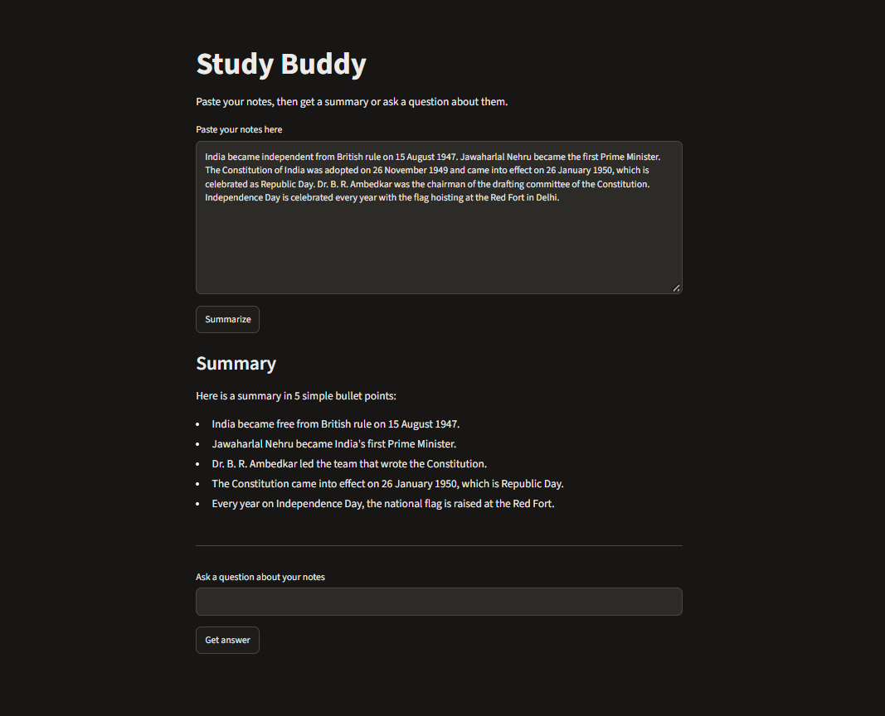
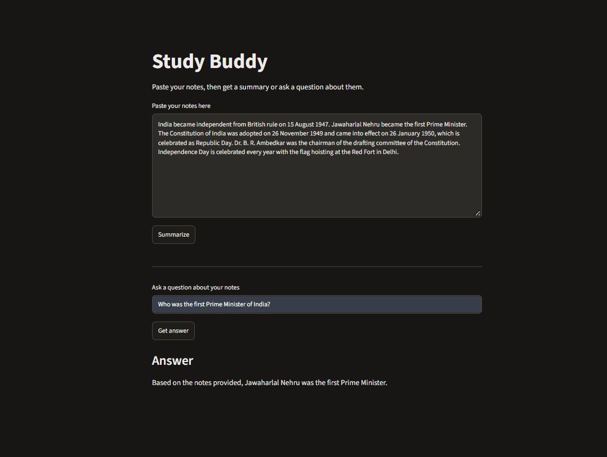

# Study Buddy 📚

Study Buddy is a simple Generative AI web app that helps students understand and revise their study notes. Paste your notes, and the AI gives you a short summary or answers your questions about them.

## Features

- **Summarization:** Turns long notes into 5 simple bullet points.
- **Question & Answer:** Answers questions using only the notes you provide. If the answer is not in the notes, it says so.
- **Simple Interface:** Easy-to-use web page built with Streamlit.
- **Backup models:** If one AI model is busy or unavailable, the app tries the next one.
- **Error handling:** Shows a friendly message instead of crashing when the API has a problem.

## Screenshots

### Summary

### Question and Answer

## How It Works

1. The user pastes notes into the web page (built with Streamlit).
2. The app sends the notes and an instruction (a prompt) to the Google Gemini API.
3. The AI replies, and the app shows the summary or the answer.

## Technologies Used

- Python
- Streamlit
- Google Gemini API
- Google GenAI SDK
- python-dotenv

## How to Run the Project

1. Clone this repository and open the project folder.
2. Create and activate a virtual environment:

   `python -m venv venv`

   `venv\Scripts\activate` (Windows) or `source venv/bin/activate` (Mac/Linux)

3. Install the required packages:

   `pip install -r requirements.txt`

4. Create a `.env` file in the project folder.
5. Add your Gemini API key (get a free key from Google AI Studio):

   `GOOGLE_API_KEY=your_api_key`

6. Run the application:

   `streamlit run app.py`

## What I Learned

- How to connect Python code to an LLM API
- How prompts control the AI's answers (it answers only from the notes)
- How to keep API keys safe with a `.env` file and `.gitignore`
- How to handle API errors such as busy servers (503), timeouts (504) and wrong model names (404)

## Future Improvements

- PDF file upload
- Automatic quiz generation
- Keep the summary and the answer on the page together
- Improved user interface

## Author

Sneha M